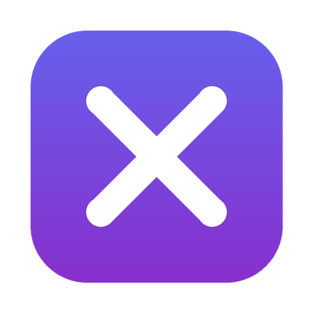

<p align="center">
  
</p>

<h1 align="center">Xssential</h1>

<p align="center">
  The essential toolkit for your desktop. Free and open source, for macOS and Windows.
</p>

<p align="center">
  <a href="https://github.com/ChiragBhargavaa/Xssential/releases/latest">Download</a> ·
  <a href="CONTRIBUTING.md">Contributing</a> ·
  <a href="LICENSE">MIT License</a>
</p>

---

## Download

| Platform                        | Installer                                                                                                                        |
| ------------------------------- | -------------------------------------------------------------------------------------------------------------------------------- |
| macOS (Apple Silicon and Intel) | [Xssential-mac-universal.dmg](https://github.com/ChiragBhargavaa/Xssential/releases/latest/download/Xssential-mac-universal.dmg) |
| Windows 10+ (64-bit)            | [Xssential-win-setup.exe](https://github.com/ChiragBhargavaa/Xssential/releases/latest/download/Xssential-win-setup.exe)         |

## Features

Xssential lives in the menu bar (macOS) or the notification area (Windows). Press
<kbd>⌥</kbd> <kbd>⇧</kbd> <kbd>X</kbd> (<kbd>Alt</kbd>+<kbd>Shift</kbd>+<kbd>X</kbd> on Windows) anywhere to open the
tool wheel, then click a tool or press its number (1–6). The shortcut can be changed in Settings.

| Tool           | What it does                                                                                                                                                                                                                                                                                                                               |
| -------------- | ------------------------------------------------------------------------------------------------------------------------------------------------------------------------------------------------------------------------------------------------------------------------------------------------------------------------------------------ |
| **Screenshot** | Freezes the screen so you can drag out an area, then opens it in the editor: crop, blur private details, round the corners, add a shadow and a gradient, color or image background, and fit it to an X post size. Download it as a JPEG, copy it, or post it on X: sign in on X's own page and Xssential attaches the image to a new post. |
| **Record**     | Records a screen or a window to MP4, then opens the video editor.                                                                                                                                                                                                                                                                          |
| **Edit video** | Opens your own video. Trim, crop, blur areas (for the whole clip or part of it), remove the original sound, add background music and export an MP4 for X.                                                                                                                                                                                  |
| **Carousel**   | Splits a long screenshot (or a wide panorama) into same-size slides for X's swipeable multi-image posts, cutting between lines of text instead of through them.                                                                                                                                                                            |
| **Edit image** | The screenshot editor for an image you already have (open, paste or drop it).                                                                                                                                                                                                                                                              |

### X sizes used

- **Images:** 16:9 (1600 × 900), which looks the same on the web and on phones, and 4:5 (1080 × 1350), which shows in full on phones and takes up more of the timeline. Up to 4 images per post, 5 MB each ([X media best practices](https://docs.x.com/x-api/media/quickstart/best-practices)).
- **Carousels:** since mid-2026 X shows posts with 2–4 images as a swipeable carousel. Portrait 4:5 (the default) and 3:4 show uncropped on the web and in the app; 9:16 is only shown in full on iOS; landscape is capped at 20:17. Keep every slide the same shape.
- **Video:** MP4 with H.264 High profile and AAC-LC audio at 30 or 60 fps, at least 5 Mbps, up to 1080p (16:9, 1:1, 4:5 or 9:16).

### Screen recording permission (macOS)

Screenshots and recordings need macOS's Screen Recording permission. The first time you pick one of
those tools, Xssential opens a short setup window: it adds itself to the list in System Settings, waits
for you to switch it on, then restarts itself (or follows macOS's "Quit & Reopen") and goes straight
back to the tool you picked.

### Background music

The free music library searches [Openverse](https://openverse.org) for tracks licensed CC0, public domain or CC BY, which can be used in any post. CC BY tracks need a credit; Xssential shows the credit line and can copy it for you. You can also use your own audio file.

## Repository layout

This is a [pnpm](https://pnpm.io) monorepo:

```
apps/
  desktop/   Electron + React + Vite + Tailwind desktop app (electron-vite, electron-builder)
  web/       Next.js landing page, exported as a static site
.github/
  workflows/
    ci.yml        Format, typecheck and build on every push and PR
    release.yml   Builds the macOS and Windows installers and publishes them to GitHub Releases
    pages.yml     Deploys the landing page to GitHub Pages
```

## Development

Requirements: Node.js 22.12+ and pnpm 10 (`corepack enable` installs the pinned pnpm).

```bash
pnpm install
pnpm dev:desktop   # run the desktop app with hot reload
pnpm dev:web       # run the landing page at http://localhost:3000
```

To open a tool straight away while developing, set `XSSENTIAL_OPEN_TOOL` to one of `screenshot`,
`record`, `edit-video`, `carousel`, `edit-image` or `settings`:

```bash
XSSENTIAL_OPEN_TOOL=carousel pnpm dev:desktop
```

On macOS, screenshots and recordings need the Screen Recording permission (System Settings → Privacy &
Security → Screen & System Audio Recording). In development the permission belongs to the terminal app
that runs `pnpm dev:desktop`, so switch that app on and restart the dev command.

Other scripts:

| Command                           | What it does                                      |
| --------------------------------- | ------------------------------------------------- |
| `pnpm build`                      | Build both apps                                   |
| `pnpm typecheck`                  | Typecheck both apps                               |
| `pnpm format`                     | Format everything with Prettier                   |
| `pnpm dist:mac` / `pnpm dist:win` | Build installers locally into `apps/desktop/dist` |

Build each installer on its own OS: macOS builds need a Mac, and Windows builds are most reliable on Windows. CI handles both.

## Releasing

1. Bump `version` in `apps/desktop/package.json` (for example `0.2.0`) and commit.
2. Tag and push:
   ```bash
   git tag v0.2.0
   git push origin main --tags
   ```
3. The **Release desktop app** workflow builds `Xssential-mac-universal.dmg` and `Xssential-win-setup.exe` and publishes them to a GitHub Release.

The landing page and the table above link to `releases/latest/download/<file>`, so they point at the new version as soon as it is published. Installed apps update themselves through `electron-updater`.

### Code signing (optional, recommended)

Without signing, the release still builds, but macOS Gatekeeper and Windows SmartScreen warn users when they open the app. To sign, add these repository secrets:

| Secret                                                     | Purpose                                                 |
| ---------------------------------------------------------- | ------------------------------------------------------- |
| `MAC_CSC_LINK`, `MAC_CSC_KEY_PASSWORD`                     | Base64 Developer ID Application `.p12` and its password |
| `APPLE_ID`, `APPLE_APP_SPECIFIC_PASSWORD`, `APPLE_TEAM_ID` | Notarization with Apple                                 |
| `WIN_CSC_LINK`, `WIN_CSC_KEY_PASSWORD`                     | Windows code signing certificate                        |

Auto-update on macOS only works for signed builds.

## Landing page hosting

The site is a static export (`apps/web/out`), so it can be hosted anywhere:

- **GitHub Pages:** go to _Settings → Pages_ and set **Source** to **GitHub Actions**. `pages.yml` deploys on every push to `main` that touches `apps/web`.
- **Vercel / Netlify / Cloudflare Pages:** set the root directory to `apps/web`, the build command to `pnpm build` and the output directory to `out`.

## Thanks

The photo backgrounds in the screenshot and video editors are free photos from
[Unsplash](https://unsplash.com), used under the [Unsplash License](https://unsplash.com/license).
Thank you to the photographers who share their work:

| Background | Photographer                                                    | Photo                                                                     |
| ---------- | --------------------------------------------------------------- | ------------------------------------------------------------------------- |
| Blush      | [Allison Saeng](https://unsplash.com/@allisonsaeng)             | [Pink and purple blur](https://unsplash.com/photos/ecwIyHRmThI)           |
| Violet     | [Mohammed Kara](https://unsplash.com/@sharkx7)                  | [Purple and white gradient](https://unsplash.com/photos/ojW42O2Hpec)      |
| Indigo     | [MagicPattern](https://unsplash.com/@magicpattern)              | [Purple and blue blur](https://unsplash.com/photos/8h_tctpq4h0)           |
| Aurora     | [Milad Fakurian](https://unsplash.com/@fakurian)                | [Purple and pink gradient waves](https://unsplash.com/photos/nY14Fs8pxT8) |
| Prism      | [Codioful (formerly Gradienta)](https://unsplash.com/@codioful) | [Purple and pink light](https://unsplash.com/photos/O10vBIDRkZw)          |
| Crimson    | [MagicPattern](https://unsplash.com/@magicpattern)              | [Red and black blur](https://unsplash.com/photos/iAR6yhCkrxc)             |
| Ember      | [Antonius Harel](https://unsplash.com/@antoniushareel)          | [Warm orange and white gradient](https://unsplash.com/photos/WsaPcg512jE) |
| Rust       | [Josiah Rock](https://unsplash.com/@josiahrock)                 | [Orange, blue and brown blend](https://unsplash.com/photos/7EnvCCL8XGE)   |
| Silk       | [Universtock](https://unsplash.com/@universtock)                | [Orange and blue fluid](https://unsplash.com/photos/spmU0phaFDc)          |
| Dusk       | [Mohammad Alizade](https://unsplash.com/@mohamadaz)             | [Sunset over water](https://unsplash.com/photos/SB5MIXFjJxs)              |
| Forest     | [Kunal Patil](https://unsplash.com/@kunalptll)                  | [Green blur](https://unsplash.com/photos/2hB-jhXLd3c)                     |
| Lagoon     | [Ikhlas](https://unsplash.com/@byikhlas)                        | [Blue and white blur](https://unsplash.com/photos/u_WdZULW1Go)            |
| Glacier    | [Zaky Jundana](https://unsplash.com/@zakyjundanaphotos)         | [Blue and white gradient](https://unsplash.com/photos/6grFyaQVt24)        |

## Contributing

Contributions are welcome. See [CONTRIBUTING.md](CONTRIBUTING.md).

## License

[MIT](LICENSE)
